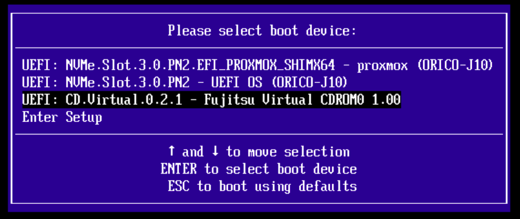
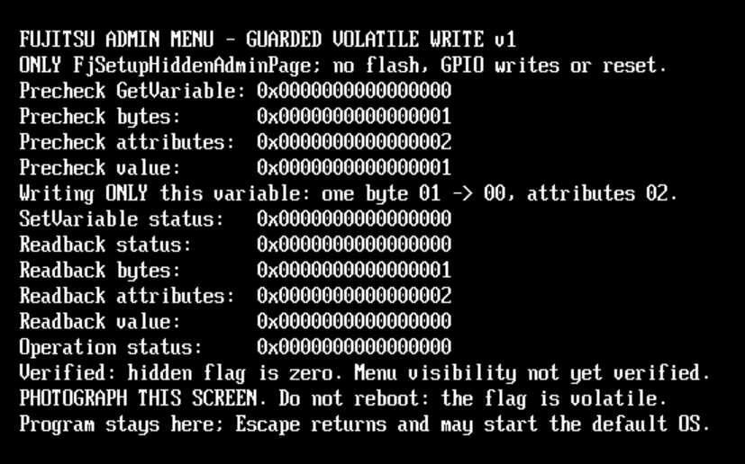
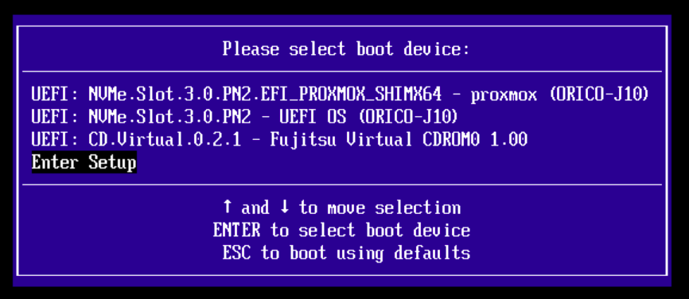
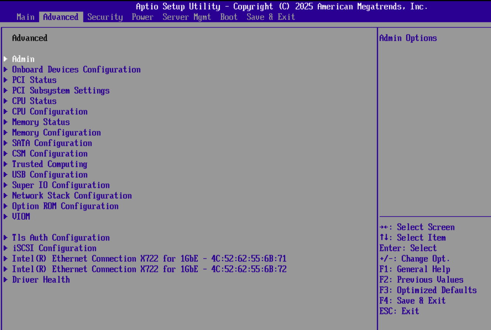

# Fujitsu Admin Menu Unlock

`admin-menu-unlock.iso` is a bootable UEFI utility that exposes the hidden vendor **Admin** menu in the server's BIOS for a single boot session.

By toggling an internal firmware variable in volatile memory, it temporarily unlocks hundreds of suppressed platform configuration options including low-level CPU controls, memory timings, PCIe topology and bifurcation, TPM policies, and overclocking parameters. The unlock is strictly non-persistent: no modifications are written to the SPI flash or persistent NVRAM, and standard access restrictions automatically re-engage on the next boot.

Download bootable *.iso file here: [admin-menu-unlock.iso](https://github.com/davidkirberich/fujitsu-admin-menu-unlock/blob/main/build/admin-menu-unlock.iso)

**(WARNING: USE AT OWN RISK! THIS IS NOT AN OFFICIAL FUJITSU TOOL!)**

## Instructions

Step 1: Select the virtual drive containing the ISO (Fujitsu Virtual CDROM0) from the boot menu and press Enter.



Step 2: Wait for the verification confirmation (Verified: hidden flag is zero) and exit the utility by pressing Escape without resetting the server.



Step 3: Select Enter Setup from the boot menu to enter the BIOS configuration directly.



Step 4: Navigate to the Advanced tab to access the newly unlocked Admin menu.



## Tested Target Baseline

| Component | Tested Baseline |
|---|---|
| **Server** | Fujitsu PRIMERGY TX2550 M5 |
| **Mainboard** | D3386-B1 |
| **BIOS** | V5.0.0.14 R1.44.0 (2025-09-30) |
| **Boot Mode** | x86-64 UEFI (Legacy BIOS unsupported) |

> **Important:** Other models or firmware revisions are unverified. The utility does not check system model or BIOS version strings; it strictly checks the target UEFI variable (GUID, size, attributes, value). Passing these safety checks does not guarantee broader hardware compatibility.

---

## Behavior & Safety

The utility performs a single, non-interactive write attempt automatically at boot.

### Target Variable

```text
Name:       FjSetupHiddenAdminPage
GUID:       77d054d6-53c6-4215-b9c3-66637fcab7ce
Size:       1 byte
Attributes: 0x02 (Boot Service access, volatile)
```

- **Logic:** Writes `00` strictly if the read succeeds, size/attributes match, and the current value is `01`.
- **Safety:** Aborts without writing on read errors or unexpected values. Skips write if the value is already `00`.
- **Scope:** Volatile runtime modification only (not persistent). Verifies write status and performs a post-write read-back. No retries, resets, NVRAM flashing, GPIO, or disk writes.
- **Exit:** Halts on the status screen. Pressing `Esc` exits the application to proceed with standard OS boot.

---

## Repository Structure

| File | Purpose |
|---|---|
| `admin-menu-unlock.c` | UEFI write payload |
| `admin-gate-readonly.c` | Shared UEFI types and console output helpers |
| `test-admin-menu-unlock.c` | Host unit tests with mock UEFI runtime |
| `build.ps1` | Build orchestration (tests, EFI compilation, ISO creation) |
| `build-iso.py` | FAT12 / El Torito ISO generator and verification |
| `requirements.txt` | Python dependencies for ISO generation |

---

## Build Instructions (Windows / PowerShell)

### Prerequisites

- Python with `venv`/`pip`
- x64 MinGW-w64 GCC (`x86_64-w64-mingw32-gcc`) in `PATH`
- *No EDK II or proprietary Fujitsu headers required.* Tests run natively on Windows with simulated firmware callbacks.

### Build Steps

```powershell
python -m venv .venv
.\.venv\Scripts\pip install -r .\requirements.txt
.\build.ps1 -Python .\.venv\Scripts\python.exe
```

If your x64 MinGW compiler is named `gcc`:

```powershell
.\build.ps1 -Compiler gcc -Python .\.venv\Scripts\python.exe
```

Output artifacts in `build/`:
- `admin-menu-unlock.efi`
- `admin-menu-unlock.img`
- `admin-menu-unlock.iso`
- `test-admin-menu-unlock.exe`

---

## Notes & Limitations

- **Validation:** The build script verifies PE headers, the EFI subsystem, DLL imports, and image integrity. It will not overwrite existing build artifacts.
- **Secure Boot:** The generated EFI binary is unsigned; Secure Boot must be disabled to execute it.. The utility does not check system model or BIOS version strings—it strictly checks the target UEFI variable (GUID, size, attributes, value). Passing these safety checks does not guarantee broader hardware compatibility.

---

## Behavior & Safety

The utility performs a single, non-interactive write attempt automatically at boot.
